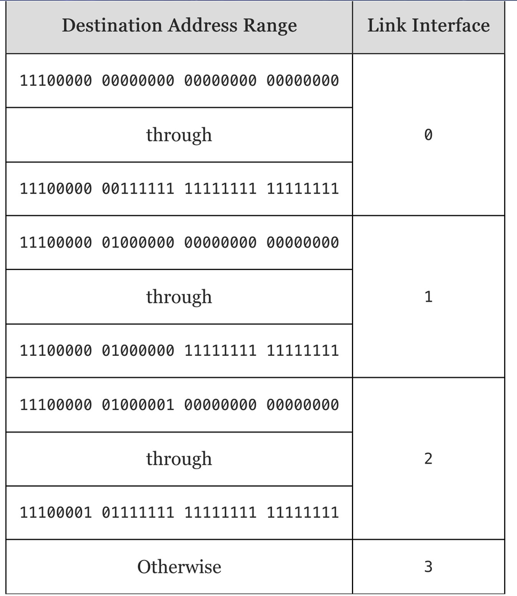

# HW 8

## Q1

Use your own device or a lab computer. Phones and tablets are not accepted for this question. Connect to the network you normally use, and turn off any VPN first.

Step 1: Find your device’s IPv4 address.

    Windows: open Command Prompt and run ipconfig. Find the adapter that is connected. It is the one that lists a “Default Gateway”. Write down its IPv4 Address.
    Mac: open Terminal and run ipconfig getifaddr en0. If it prints nothing, open System Settings, then Wi-Fi (or Ethernet), then Details, then TCP/IP, and copy the IP address from there.
    Linux:open a terminal on your own device (not an SSH session) and run ip -4 -brief addr. Ignore the lo line. On the line for your connected interface (its state says UP), write down the IP address only.

Step 2: Find your public address.
Open https://ifconfig.me Links to an external site. in a browser and write down the address it shows. If it shows a long address with colons, that is IPv6. In that case, open a terminal and run curl -4 ifconfig.me (Mac, Linux, or Windows Command Prompt) or curl.exe -4 ifconfig.me (Windows PowerShell), and report that address instead.

Step 3: Answer the following (2 to 3 sentences each).

+ Is your device’s IPv4 address in a private range? Which one? (See the NAT subsection of K&R 4.3)
+ Is your public address different from your device’s address? If it is different, which device between you and the Internet is likely translating, and what does it translate? If they are the same, say so and explain what that means for your network.

### A1

**Step 1**

IPv4 listed: 10.25.24.107

```
Wireless LAN adapter Wi-Fi:

   Connection-specific DNS Suffix  . : 
   IPv6 Address. . . . . . . . . . . : 2600:1011:b1ab:a6ca:e38d:9e4a:6957:8db6
   Temporary IPv6 Address. . . . . . : 2600:1011:b1ab:a6ca:258f:a7a0:752b:3dd5
   Link-local IPv6 Address . . . . . : fe80::f8ef:4e8a:94cb:5479%7
   IPv4 Address. . . . . . . . . . . : 10.25.24.107
   Subnet Mask . . . . . . . . . . . : 255.255.255.0
   Default Gateway . . . . . . . . . : fe80::80f9:2fff:fe74:75a8%7
                                       10.25.24.80
```

**Step 2**

Showed IPv6 for me, so running the curl command: 174.238.225.207

**Step 3**

*Is your device’s IPv4 address in a private range? Which one? (See the NAT subsection of K&R 4.3)*

The device address is in a private range (10.25.24.107). The range is within the 10.0.0.0/8 range. The 10.0.0.0/8 range covers IP addressses 10.0.0.0 - 10.255.255.255, covering 2^(32 - 8) = 2^24 total addresses.

*Is your public address different from your device’s address? If it is different, which device between you and the Internet is likely translating, and what does it translate? If they are the same, say so and explain what that means for your network.*

Yes, my public address is different from my device's (174.238.225.207). I am currently connected to my phone's hotspot, so my phone is likely performing nertwork address translation (NAT) to cover the details of my home network. It's very likely that many mobile devices with Verizon are using the same "world" IP so that they can share an outer-facing IP and use private range IP's to distinguish multiple users.

## Q2

Consider a router that interconnects three subnets: Subnet 1, Subnet 2, and Subnet 3. Suppose all of the interfaces in each of these three subnets are required to have the prefix 223.3.17/24. Also suppose that Subnet 1 is required to support at least 60 interfaces, Subnet 2 is to support at least 90 interfaces, and Subnet 3 is to support at least 12 interfaces. Provide three network addresses (of the form a.b.c.d/x) that satisfy these constraints.

### A2

**assignment 1**

S1: 223.3.17.128/26
S2: 223.3.17.0/25
S3: 223.3.17.192/28

*explanation*
+ S2 is the largest chunk, so we can choose the prefix 25 to get 2^(32 - 25) = 2^7 = 128 addresses.
+ Likewise, we can choose prefixes /26 and /28 to get 64 and 16 addresses for S1 and S3. 
  + Now we've met the minimum needed for each subnet on the prefix front.
+ First assign the largest subnet to the starting of the addresses: S2: 223.3.17.0/25 (addresses 223.3.17.0 - 223.3.17.127).
+ Next assign the second largest, and we can start it right where S2 ends: S1: 223.3.17.128/26 (addresses 223.3.17.128 - 223.3.17.191)
+ Finally, we can put S3 where S2 ends: S3: 223.3.17.192/28 (addresses 223.3.17.192 - 223.3.17.207)
+ Unused addresses: 223.3.17.208 - 223.3.17.255

**assignment 2**

S1: 223.3.17.128/26
S2: 223.3.17.0/25
S3: 223.3.17.192/27

*explanation*
+ The only change from the above is that we overallocated 32 addresses to S3 (prefix 28 -> 27).
+ Therefore the only change is that the unused addresses are now: 223.3.17.224 - 223.3.17.255

**assignment 3**

S1: 223.3.17.192/26
S2: 223.3.17.0/25
S3: 223.3.17.128/28

*explanation*
+ We still allocate S2 to the first chunk (addresses 223.3.17.0 - 223.3.17.127).
+ Then we allocate S3 next instead (addresses 223.3.17.128 - 223.3.17.143)
+ Finally, allocate S1, but we have to start it from 192 to be a valid starting point, allocating addresses 223.3.17.192 - 223.3.17.255
+ Unused are now: 223.3.17.144 - 223.3.17.191


## Q3

Consider a datagram network using 32-bit host addresses. Suppose a router has four links, numbered 0 through 3, and packets are to be forwarded to the link interfaces as follows:




Provide a forwarding table that has five entries, uses longest prefix matching, and forwards packets to the correct link interfaces.

Describe how your forwarding table determines the appropriate link interface for datagrams with destination addresses:

    11001000 10010001 01010001 01010101

    11100001 01000000 11000011 00111100

    11100001 10000000 00010001 01110111

### A3

| Prefix | Link |
| --- | --- |
| 11100000 00 | 0 |
| 11100000 01000000 | 1 |
| 11100000 01 | 2 |
| 11100001 0 | 2 |
| otherwise | 3 |

**dest 1**

11001000 10010001 01010001 01010101 \
11001 -> this prefix matches none of the above specified. 

*goes to link 3*

**dest 2**

11100001 01000000 11000011 00111100 \
11100001 -> longest prefix match possible.

*goes to link 2*

**dest 3**

11100001 10000000 00010001 01110111 \
11100001 -> begins matching what looks like link 2 \
11100001 1 -> disqualifies match with link 2, no other matches.

*goes to link 3*

## Q4

On Thursday 10/29, Wesley Woo (Virginia Tech) will be joining us as a guest speaker. His paper, “Anyone, Anywhere, not Everyone, Everywhere: Starlink Doesn’t End the Digital Divide” (2025), is listed as optional reading on the course calendar.

For this question, you do not need to read the whole paper. Instead try skimming some parts:

    Read the abstract.
    Look at at least two figures or tables, and skim the section headings.
    Read the final paragraph.

Then answer:

    What is one thing that stood out, surprised, or confused you? (1 to 2 sentences)
    What is one question you’d like to ask Wesley? It can be about the paper, his research, his career path, or anything else you’re curious about.

If you submit this assignment after the guest lecture that is alright. If you do have any lingering questions for Wesley, we might be able to share them after the fact.

### A4

**Things that stood out/confused** \
Is a constellation just a funny term for an interconnected network of satellites for StarLink? Like, a Musk-branded term? I was also suprised to see that StarLink is so expensive. To see numbers like $125/mo was outright absurd for internet access. Maybe my bar is too low ($60/mo is about the northend of what I'm willing to budget personally), so to see twice my base expectation is alarming. Feels like it is more premier sattelite internet than promoting accessibility (accessible if you're a remote tech worker living your van-life, maybe).


**Question for Wesley** \
It's interesting to see the map with the number of underserved locations per starlink service cell (Figure 1). Why are there huge chunks in the middle-west of the country completely uncovered by starlink cells? Is there a particular reason for that or is it just not profitable to focus on the remote swathes of the country?

## Q5

Did you use generative AI for any part of this assignment? If so, describe how.

### A5

Did not use genAI for this assignment.