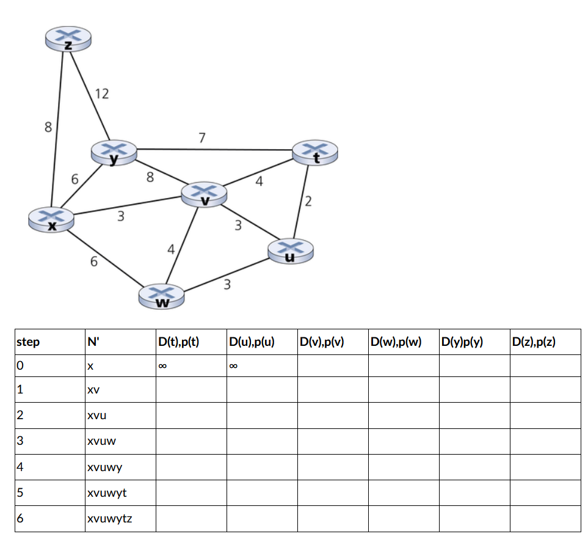
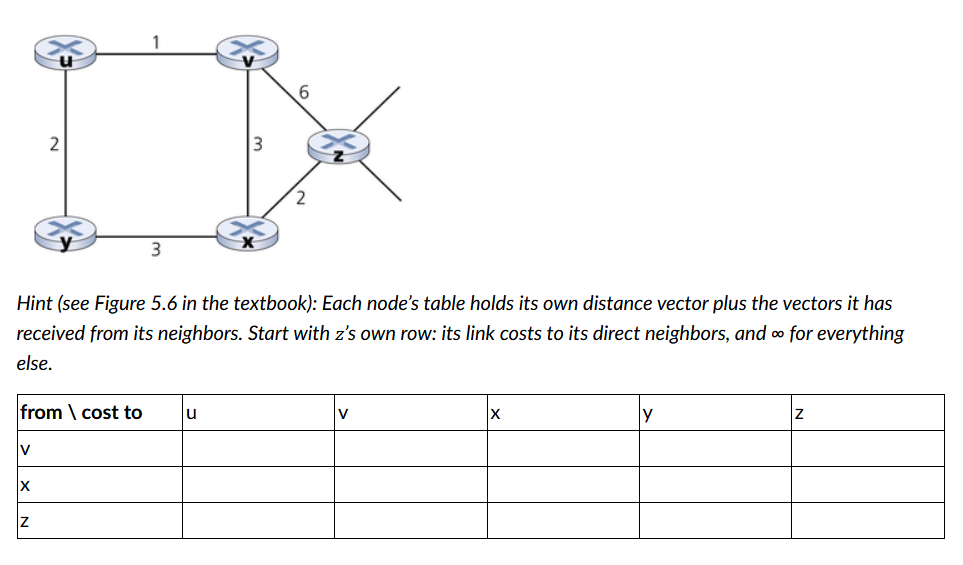

# HW 9

Watch these two videos:
+ https://www.youtube.com/watch?v=bdh2kfgxVuw
+ https://www.youtube.com/watch?v=jJU2AVX6gpU

You may supplement these by reading sections 5.1 and 5.2 from the K+R textbook (optional).

Then answer the following questions.

## Q1

Compare and contrast link-state and distance-vector routing algorithms. For each, say what a router knows and who it communicates with.

### A1

For link-state, this algorithm must have a global knowledge of the network, knowing not just its own direct paths but all paths in the network-scope it is calculating for. This can be seen in the update rules, which rely on knowledge of path weights from non-neighbors to properly compute the least-cost path properly from a single source node. The distance-vector approach, however, relies on only what is told by neighbors. The information propogates out with each time step, also allowing a certain adjustability and malleability within the network. Further, link-state will take longer to compute for a single router since it must iterate through the entire network-scope in order to find the best path and must do so to compensate for any changes; distance-vector, however, can adjust over time, which will affect the rate at which routers are aware of changes potentially, but algorithms like Bellman-Ford are notable due to their parallelizable nature, so that should be accounted for in this consideration. Lastly, link-state can perform its calculation separately from other routers, whereas a faulty calculation by one router in distance-vector could cause a rippling effect of errors. 

#### Section from book for q1 that's helpful

```
The DV and LS algorithms take complementary approaches toward computing rout-
ing. In the DV algorithm, each node talks to only its directly connected neighbors, 
but it provides its neighbors with least-cost estimates from itself to all the nodes (that 
it knows about) in the network. The LS algorithm requires global information. Con-
sequently, when implemented in each and every router, for example, as in Figures 4.2 
and 5.1, each node would need to communicate with all other nodes (via broadcast), 
but  it  tells  them  only  the  costs  of  its  directly  connected  links.  Let’s  conclude  our  
study of LS and DV algorithms with a quick comparison of some of their attributes. 
Recall that N is the set of nodes (routers) and E is the set of edges (links).
• Message  complexity.  We  have  seen  that  LS  requires  each  node  to  know  the  
cost of each link in the network. This requires O(|N| |E|) messages to be sent. 

Also, whenever a link cost changes, the new link cost must be sent to all nodes. 
The  DV  algorithm  requires  message  exchanges  between  directly  connected  
neighbors  at  each  iteration.  We  have  seen  that  the  time  needed  for  the  algo-
rithm  to  converge  can  depend  on  many  factors.  When  link  costs  change,  the  
DV  algorithm  will  propagate  the  results  of  the  changed  link  cost  only  if  the  
new link cost results in a changed least-cost path for one of the nodes attached 
to that link.
• Speed of convergence. We have seen that our implementation of LS is an O(|N|2) 
algorithm requiring O(|N| |E|)) messages. The DV algorithm can converge slowly 
and  can  have  routing  loops  while  the  algorithm  is  converging.  DV  also  suffers  
from the count-to-infinity problem.
• Robustness.  What  can  happen  if  a  router  fails,  misbehaves,  or  is  sabotaged?  
Under LS, a router could broadcast an incorrect cost for one of its attached links 
(but no others). A node could also corrupt or drop any packets it received as part 
of an LS broadcast. But an LS node is computing only its own forwarding tables; 
other nodes are performing similar calculations for themselves. This means route 
calculations are somewhat separated under LS, providing a degree of robustness. 
Under DV, a node can advertise incorrect least-cost paths to any or all destina-
tions. (Indeed, in 1997, a malfunctioning router in a small ISP provided national 
backbone routers with erroneous routing information. This caused other routers 
to  flood  the  malfunctioning  router  with  traffic  and  caused  large  portions  of  the  
Internet to become disconnected for up to several hours [Neumann 1997].) More 
generally, we note that, at each iteration, a node’s calculation in DV is passed on 
to its neighbor and then indirectly to its neighbor’s neighbor on the next iteration. 
In  this  sense,  an  incorrect  node  calculation  can  be  diffused  through  the  entire  
network under DV.
In the end, neither algorithm is an obvious winner over the other; indeed, both algo-
rithms are used in the Internet
```

## Q2

What is the “count to infinity” problem in distance-vector routing?

### A2

The count to infinity problem is a tricky issue in which the alteration of a network cost (such as increasing a cost, a connection disappearing) results in an erroneous recalculation of a node to its distance vector table. The "global-view-incorrect" calculation is then sent to other nodes, which in turn update incorrectly. In this case, the incorrect calclulations slowly increase the local cost of a route in a looping fashion, slowly counting to infinity.

A simple example below: 

```
A <-1-> B <-2-> C
```

The current tables are, say:

```
A ->
  -> B, 1, through B
  -> C, 3, through B

B -> 
  -> A, 1, through A
  -> C, 2, through C

C -> 
  -> B, 2, through B
  -> A, 3, through B
```

And then we lose connection to C.

```
A <-1-> B / C
```

B is aware the connection ends, and it must recalculate, using the value for A -> C.

```
A ->
  -> B, 1, through B
  -> C, 3, through B

B -> // knows I can get to A and C(A -> C) is 3
  -> A, 1, through A 
  -> C, 1 + 3 = 4, through // C(here - > A) + C(A -> C)
```

And B send this updated information to A, which in turn needs to update it's path to C cost since it uses B to route to C.

```
A -> // knows C(B -> C) is now 4
  -> B, 1, through B
  -> C, 4 + 1 = 5, through B // C(here -> B) + C(B -> C)

B -> 
  -> A, 1, through A 
  -> C, 4, through C 
```

Then A sends out the new information, and cycle repeats because 

```
A ->
  -> B, 1, through B
  -> C, 5, through B 

B -> // knows C(A -> C) is now 5
  -> A, 1, through A 
  -> C, 1 + 5 = 6, through C // C(here -> A) + C(A -> C)
```

And the looping continues, a "slow count to inifinity". There are ways to conteract this such as route poisoning (advertise the route as an INF cost, spreading the "poisoned route" through the network) or split horizon (do not advertise a routing path update back to the node from which it was learned).

([Helpful extra reference for this problem outside the lecture/book.](https://www.geeksforgeeks.org/computer-networks/route-poisoning-and-count-to-infinity-problem-in-routing/))

## Q3

Consider the following network. With the indicated link costs, use Dijkstra’s shortest-path algorithm to compute the shortest path from x to all network nodes. Show how the algorithm works by computing a table starting with the provided template. Leave a cell blank once its node is already in N’. Every other cell gets an entry, even if its value didn’t change from the row above.



### A3			

## Q4

Consider the network shown below, and assume that each node initially knows the costs to each of its neighbors. Consider the distance-vector algorithm and show the distance table entries at node z.



### A4 


## Q5

Did you use generative AI for any part of this assignment? If so, describe how.

### A5

No, I didn't use genAI for this assignment.

