# Reading 3.5 - 3.7 Notes

## TCP!!!

connection oriented -> connection must be established before anything else can happen

to reiterate: TCP exists only in end systems, internal network layer gives NO shit about TCP and doesn't have any idea about it

**full-duplex service** -- data can flow from A -> B and B -> A

**point to point** -- TCP allows for a single sender and a single receiver.
+ transfer of data from one sender -> many receirs in a single send operation is NOT allowed here.

**3 way handshake** -- client sends, server responds, client send ack of response

general view of sending stream --
+ client process passes stream through the socket (door of process)
+ once data through door, tcp has control of data
+ tcp directs data to connections **send buffer**
+ from time to time, tcp snags data from buffer and passes to network layer
  + weirdly lax on the timing of this in specification

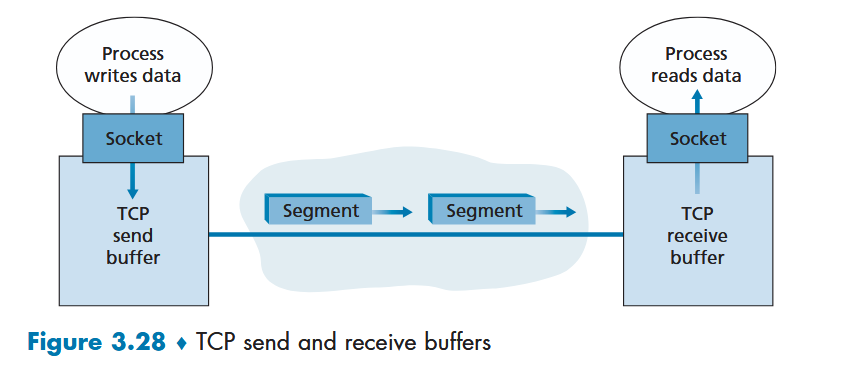

**maximum segment size (MSS)** -- max amount that can be grabbed and placed in a segment by tcp
+ typically starts with determining the length of largest link-layer fram that can be sent by local sending host (**maximum transmission unit (MTU)**) -- determine and then set the MSS such that the data + tcp/ip header can fit in that hunk
+ **NOTE!!!** MSS is the size of the data hunk, not including headers
  + so if MTU is 1500B and the tcp/ip header is 40B, then MSS is set to 1460B
    + tricky tricky!

### TCP header

TCP header includes: 

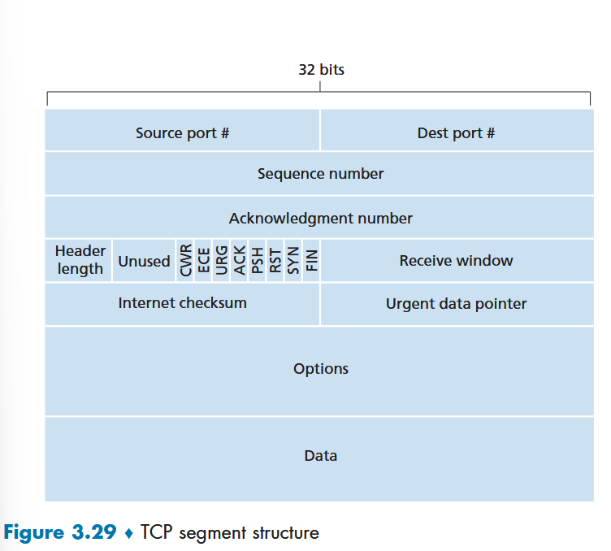

+ source and dest port numbers (remeber ip addresses are usually tacked on as a pseudo header)
+ checksum field
+ sequence number field (32 bits)
+ acknowledgement number field (32 bits)
+ header length field (4 bits) -- specifies the length of the TCP header in 32 bit words (accounts for the variable length of the header due to options field)
+ options field (variable length) -- used when sender and received negotiate an MSS or as a window scaling factor in high-speed networks
+ flag field (6 bits) 
  + **ACK** -- used to indicate value carried in ack field is valid (segment contains an acknowledgment for a segment successfully received)
  + **RST, SYN, FIN** -- used for connection setup/teardown
  + **CWR, ECE** -- congestion notification
  + not really used but still in header: 
    + **PSH** -- receiver should pass data to the upper layer immediately
    + **URG** -- data in this segment and sending side upper layer has marked urgent; location of last byte of urgent data is indicated by 16bit **urgent data pointer** field
      + TCP then must notify upper layer and pass pointer to the end of the urgent data

### segments, acknowledgements

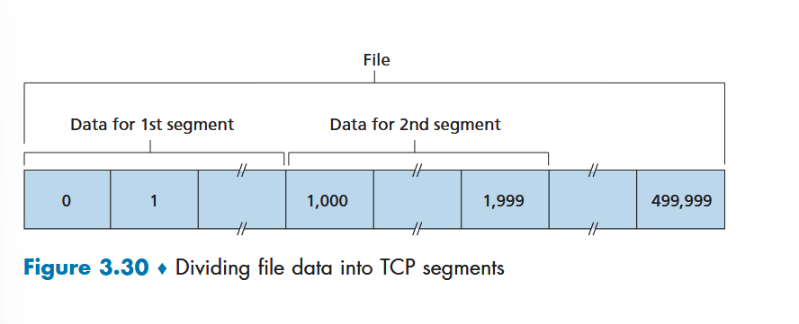
+ TCP sees data as *ORDERED* but unstructured *STREAM* of bytes
  + **sequence number** for a segment is the gyte-stream number of the FIRST byte in a segment

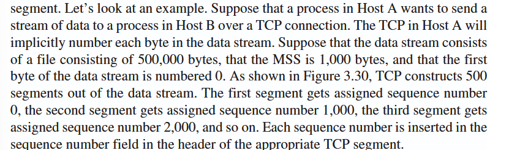

+ acknowledgement number is the number of the **sequence number of the next byte that Host 1 is expecting from Host 2**
  + TCP uses **cumulative acknowlegdements!**
    + receives out of order? sends back an ack with the last acknowledgement number they received in order (received up to 523 and got 900 - 1342? send back ack for 523 because we still need 524 - 899)
    + discard vs buffer -- up to implementation, not specified by rfc
      + typically buffer chosen in favor of bandwidth efficiency

telnet -- neato, basically each character typed by the user is first sent to host, and then sent from host back to client, and in this way ensuring that each character typed is indeed received by the host as you go.

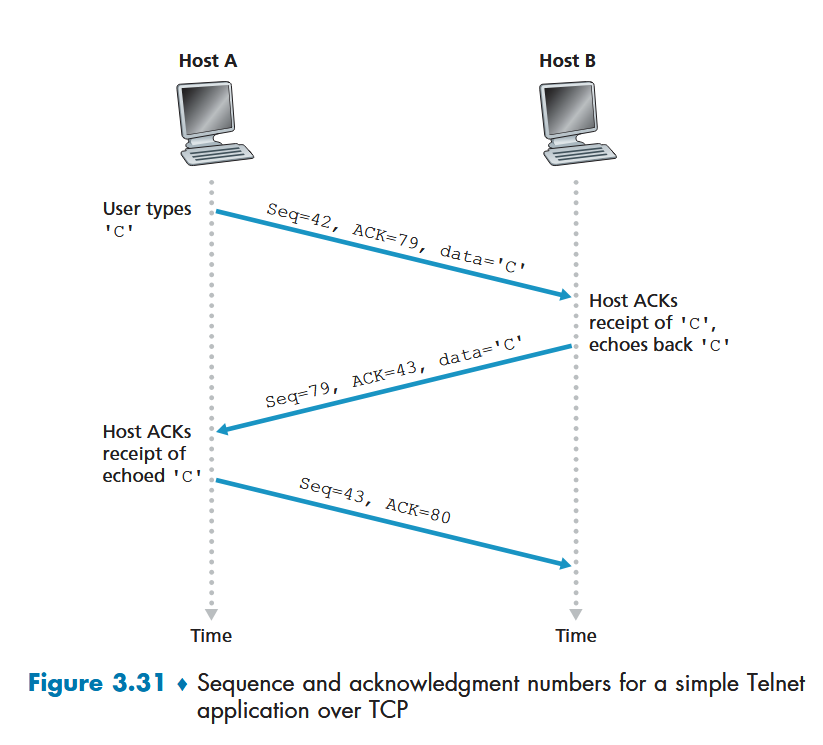
+ user types 'C' in telnet and leaves
  + seq is 42 (this is byte 42 i am sending) and ack is 79 (79th byte has been received by host A)
  + seq is 79 (i am sending you now the 79th byte) and acknowledging that i received up to byte 43 from host A (i'm ready for byte 43)
  + seq is 43 (i have received your acknowledgment seq 79 and sending back a small ack with no data -- we still use the sequence number accumulation despite no data!) and have acknowledged that i am now ready for byte 80 

### RTT and timeouts

obv want timeouts to be > RTT, but need to vibe with how much longer.

*tcp calculates a sample RTT from a segment about once every RTT and adjusts it dynamically*
+ but, can fluctuate, so a sort of average is taken
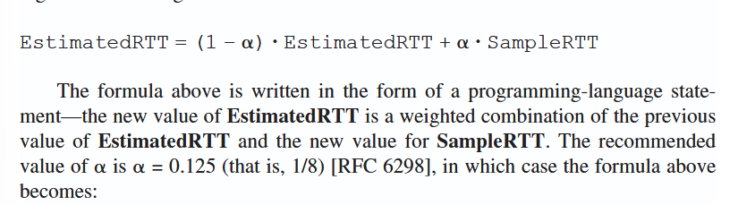
+ more weight on recent samples that older samples (*exponential weighted moving average*)
  + weight of a given smaple rtt decays exponentially when updates proceed
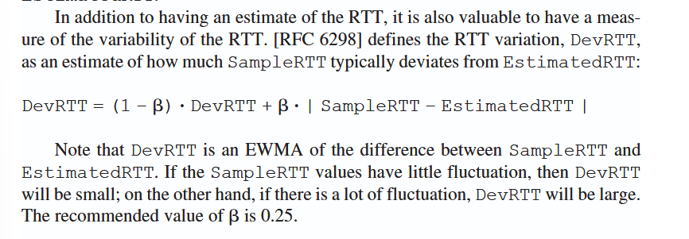

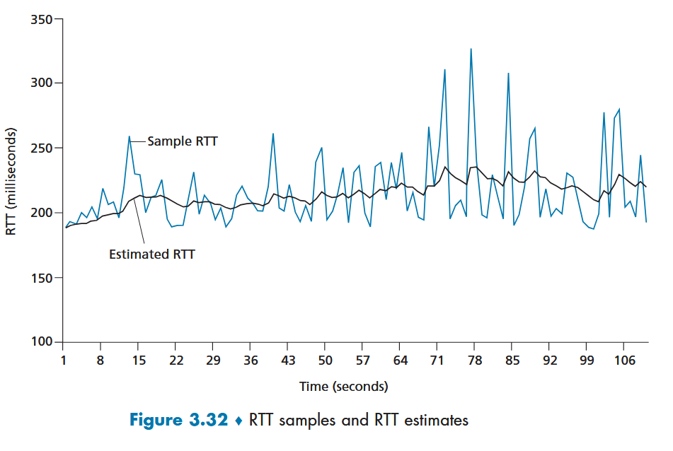

timeout interval should be >= estimated rtt then.

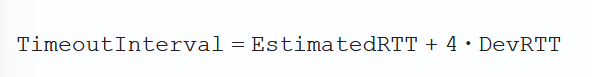
+ set an initial timeout of 1 second (recommeded)
  + if timeout does occur, timeoutInterval is doubled to avoid premature timeout for next seg
    + keep doubling as things timeout
    + as soon as seg received, estimatedRTT calc'd and timeoutInterval updated as normal above
      + is a *form* of congestion control

### reliability

one timer for retransmission recommended because a timer for each packet is a huge overhead.

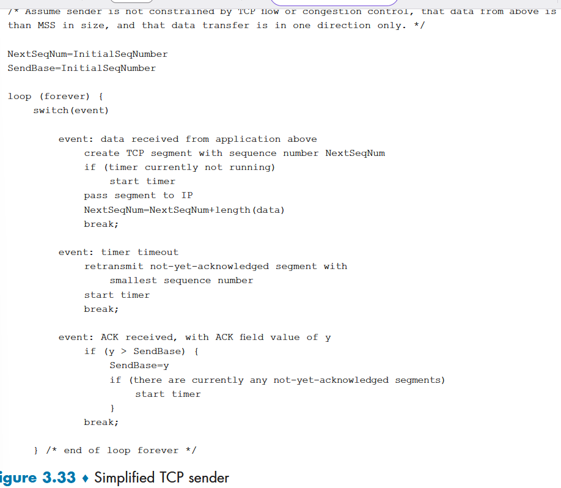
+ helpful to think of retrans timer being associated with the oldest unack'd segment

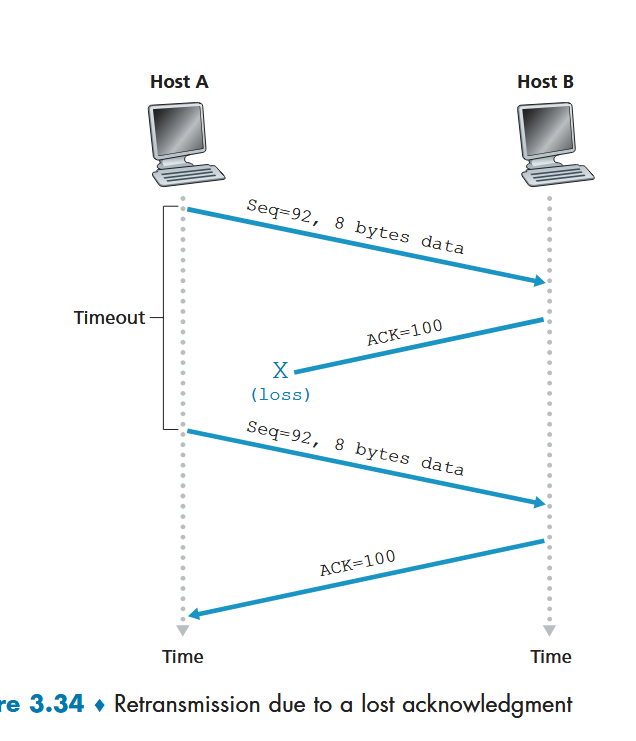

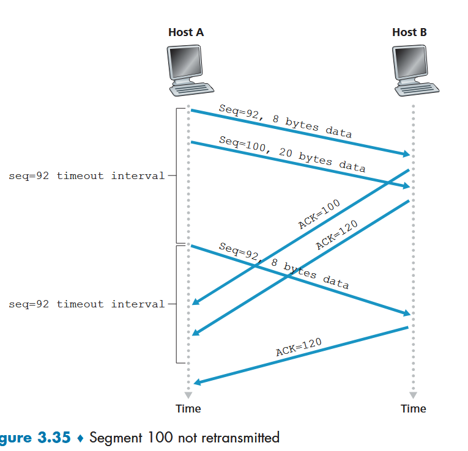

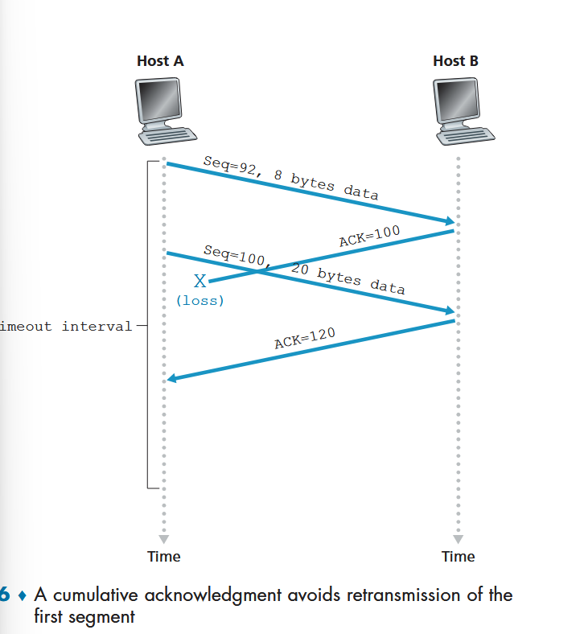

**fast retransmit**
+ doubling the timeout can cause an unnecessary delay
  + this is where duplicate ACKs come in handy

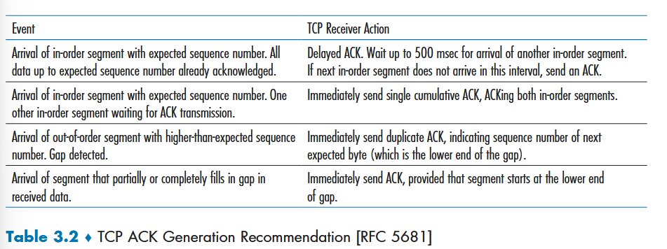
+ duplicate ack sent immediately when a gap is detected instead of waiting around
+ 3 duplicate acks indicate the segment immediately following the dup ack received is lost, and does **fast retransmit** -- send that segment again immediately even if timer is not up
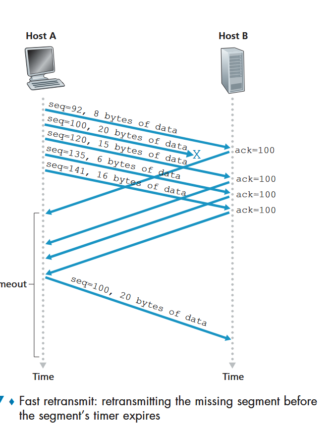

### flow control

*flow control is on the sender side, congestion control is on the receiver side*
+ flow control is the hose to the child's face
+ congestion control is the ensurance of traffic flow in the network as a whole (high way sustem clean)

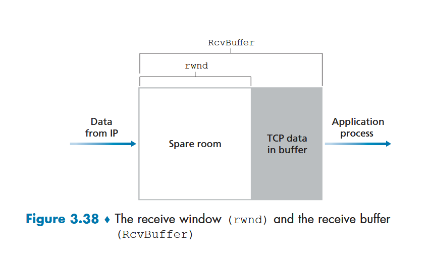

+ last byte sent and last byte ackd -> tracked by sender because its the amount of unacknowledged data that A has sent into connection
+ so, by ensuring: LastByteSent – LastByteAcked <= rwnd, A is not overflowing the buffer at receiver B
  + B tells A what rwnd is with head segment

### connection: syn, ack, synack

1. send segment with syn bit 1 (syn)
2. receiver receives, makes buffers, etc, and start tracking the client seq number as ack, and sets its own initial sequence number, send back with syn 1 (synack)
3. sender receives synack and allocates its won buffers, etc; client set server_isn+1 as the ack value and sends back an empty with syn as 0

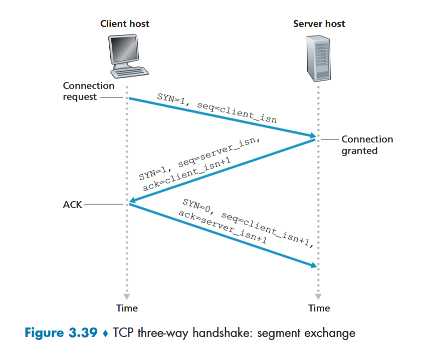

FIN bit used to close the connection

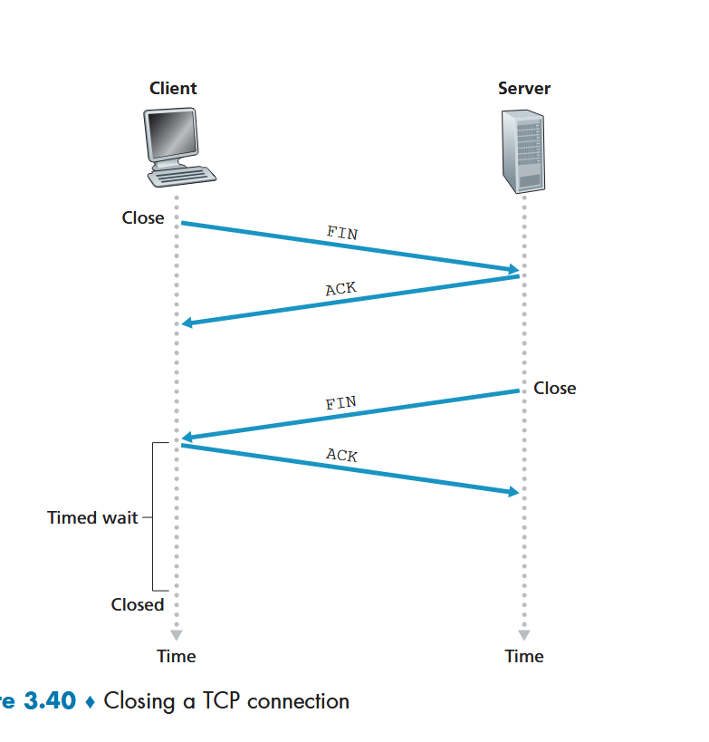

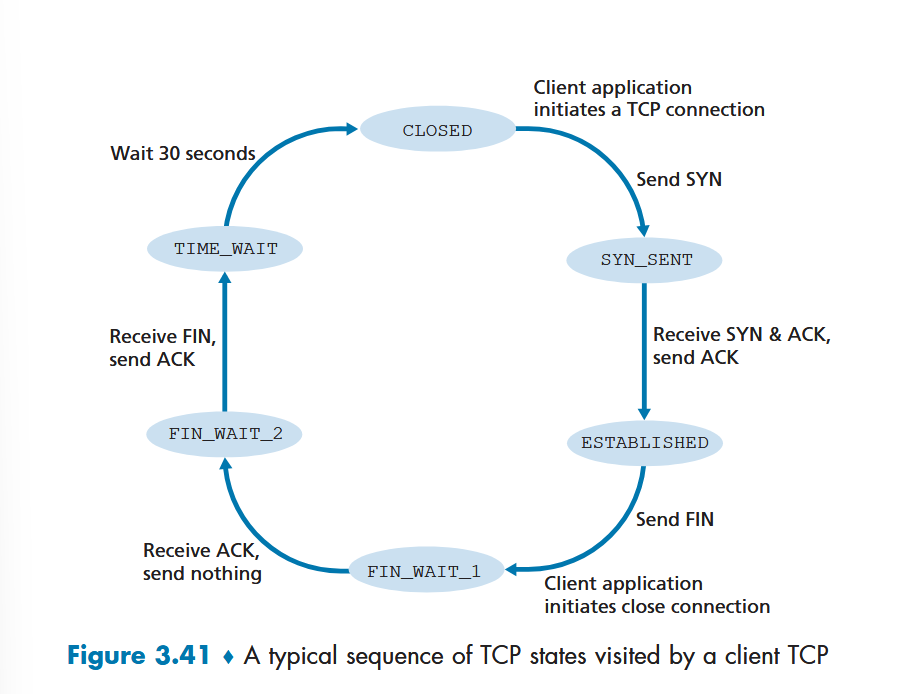
+ time_wait is so that the client can resend the final ack in case it is lost (does it always resend?)

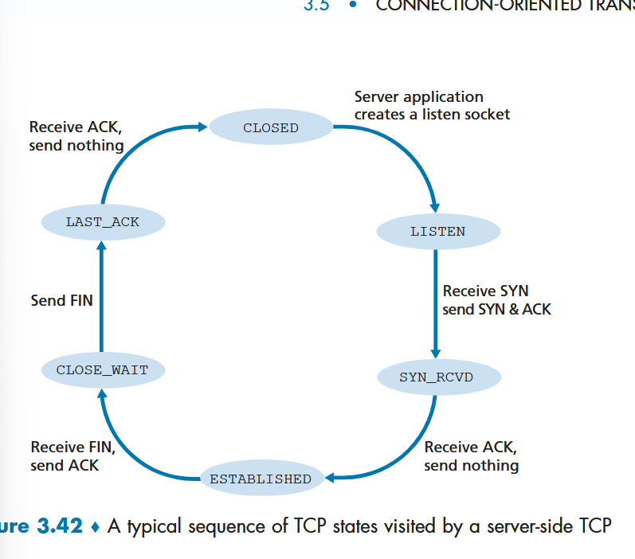

this is the general state flow but there are many cases not illustrated here.

**RST bit** is for when a syn packet sent for a port that has nothing listening for tcp (reset -- i don't have a socket for that segment, pls don't resend)
+ fun: this RST receipt is actually a great way to tell if there's a firewall -- if RST is never sent back, and no ack to the syn, then there's likely a firewall blocking that port
+ syn flooding -- send a bunch of syn's and never send the ACK in response to synack -- a bunch of resources are allocated for half open connections and real clients are denied. 